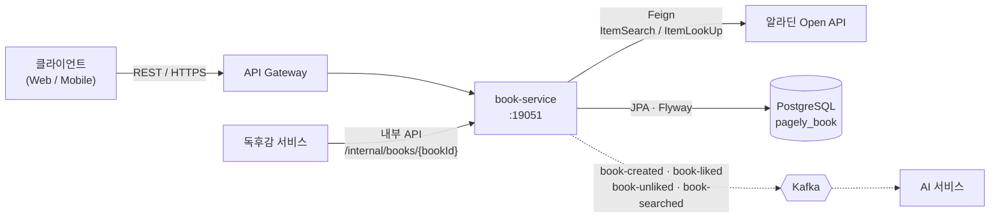
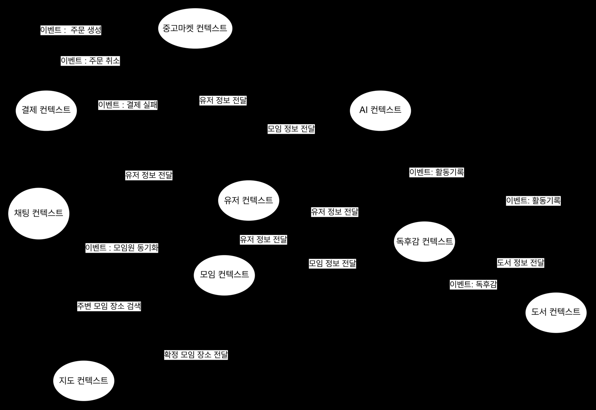
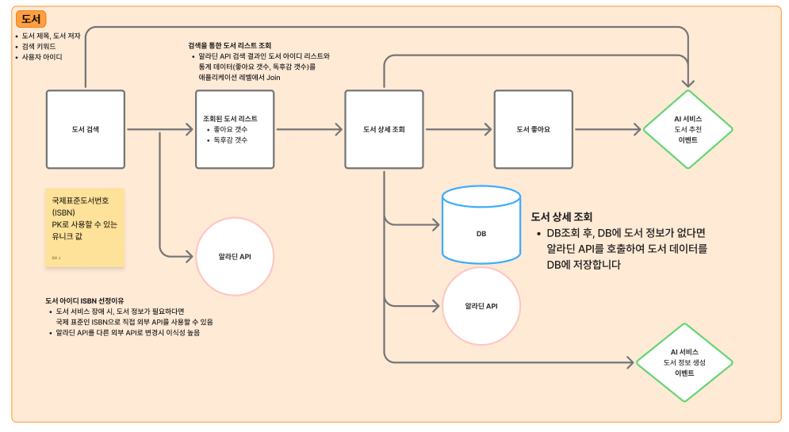
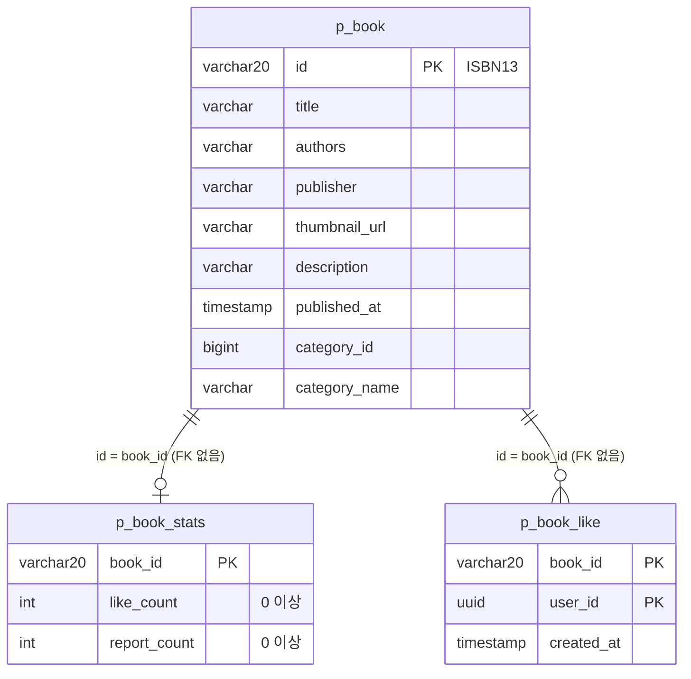

# book-service

Pagely의 도서 서비스입니다. 알라딘 Open API로 도서를 검색·조회하고, 사용자가 상호작용한 도서만 자체 DB에 저장해 좋아요와 통계를 관리합니다. 도서 생성·좋아요·검색 이벤트는 Kafka로 발행합니다.

> Pagely는 독서 모임, 중고 거래, AI 추천이 이어지는 MSA 기반 독서 플랫폼입니다. 이 저장소는 그중 도서 도메인만 담습니다.

## 담당 범위

Pagely 팀 프로젝트(6명)에서 도서 도메인을 맡아 이 서비스를 개발했습니다.

| 영역 | 내용 |
| --- | --- |
| API | 도서 검색·상세 조회, 좋아요 등록·취소, 서비스 간 도서 조회, 초기 데이터 생성 (6개 엔드포인트) |
| 외부 연동 | 알라딘 Open API 검색·상세 조회(OpenFeign), 조회 시점에 도서를 저장하는 구조, 동시 생성 충돌 처리 |
| 데이터 | Flyway로 관리하는 3개 테이블 (`p_book`, `p_book_like`, `p_book_stats`) |
| 이벤트 | 도메인 이벤트와 Port-Adapter 구조로 Kafka 4개 토픽을 커밋 후 발행 |
| 운영 | Actuator·Prometheus 지표 노출, k6 시나리오 6종, Connection Pool 크기 비교(10 / 13 / 20) |
| 협업 | GitHub Actions PR 빌드, 브랜치 이름 검사, 리뷰어 자동 할당 설정 |

인증·응답·페이징 같은 공통 코드는 팀 공통 모듈(`com.pagely:common`)을 사용합니다.

## 시스템에서의 위치



실선은 동기 호출, 점선은 비동기 이벤트입니다. 서비스별로 DB를 따로 사용합니다.

### 컨텍스트 맵


도서 컨텍스트는 독후감 컨텍스트에 도서 정보를 전달하고, AI 컨텍스트에 활동 기록 이벤트를 보냅니다.

## 도메인 플로우



1. **도서 검색**: 알라딘 API 검색 결과의 도서 ID(ISBN) 목록에 좋아요·독후감 수를 애플리케이션 레벨에서 합칩니다. 검색 내역은 `book-searched` 이벤트로 발행합니다.
2. **도서 상세 조회**: DB에 도서가 없으면 알라딘 API로 조회해 DB에 저장하고(`book-created` 이벤트 발행), 있으면 DB 데이터를 반환합니다.
3. **도서 좋아요**: 좋아요 등록·취소 시 `book-liked`, `book-unliked` 이벤트를 발행합니다.

## 설계 결정

| 결정 | 이유 |
| --- | --- |
| 도서 ID를 ISBN13으로 사용 | 국제 표준 값이라 어떤 경로로 받아도 같은 도서임이 보장됩니다. 도서 서비스 장애 시에도 ISBN으로 외부 API를 직접 조회할 수 있고, 알라딘을 다른 외부 API로 바꿀 때 이식하기 쉽습니다. |
| 도서를 조회·좋아요 시점에 저장 | 사용자가 상호작용한 도서만 DB에 둡니다. 좋아요는 중복 여부를 먼저 확인한 뒤 도서를 생성해 불필요한 외부 API 호출을 줄입니다. |
| 동시 생성 충돌 처리 | ISBN이 키라서 여러 요청이 동시에 같은 도서를 생성하면 키가 충돌할 수 있습니다. `DataIntegrityViolationException`을 잡아 이미 저장된 도서를 다시 조회합니다. |
| 좋아요에 FK 제약을 두지 않음 | 도서 삭제는 현재 비즈니스 로직에 없고, 삭제되더라도 외부 API로 복구할 수 있습니다. ISBN이 키여서 같은 도서임이 보장됩니다. |
| 커밋 후 이벤트 발행 | 생성·좋아요·취소 이벤트는 `@TransactionalEventListener(AFTER_COMMIT)`에서 Kafka로 보냅니다. 검색 이벤트는 검색이 비어 있어도 내역이 남도록 `@EventListener`로 즉시 발행합니다. |
| Kafka 메시지에 타입 헤더를 넣지 않음 | `spring.json.add.type.headers: false`로 JSON만 보냅니다. 소비하는 서비스가 발행 측 클래스 경로에 의존하지 않습니다. |
| Port-Adapter 구조 | 알라딘 API, Kafka, 영속성을 `application/port`의 인터페이스 뒤로 두고 `infrastructure`가 구현합니다. 외부 의존을 바꿔도 도메인과 서비스 코드는 유지됩니다. |

## API

유저 대상 API는 `MASTER`, `USER`, `CREATOR` 역할이 호출할 수 있고, 관리자 대상 API는 `MASTER`만 호출할 수 있습니다. 구분의 "외부"는 클라이언트용, "내부"는 서비스 간 호출용입니다.

| 구분 | 대상 | Method | Path | 설명 | 응답 |
| --- | --- | --- | --- | --- | --- |
| 외부 | 유저 | GET | `/api/v1/books/search` | 검색어(`query`)와 검색 타입(`queryType`, 기본 `Title`)으로 도서를 페이지(`page` 기본 0, `size` 기본 10) 단위로 조회합니다. 알라딘 API로 검색하고 좋아요·독후감 수를 함께 표시합니다. 검색 기록은 추천에 사용됩니다. | 200 |
| 외부 | 유저 | GET | `/api/v1/books/{bookId}` | 도서를 상세 조회합니다. 좋아요·독후감 수를 포함하고, 조회 기록은 추천에 사용됩니다. | 200 |
| 외부 | 유저 | POST | `/api/v1/books/{bookId}/like` | 도서 좋아요를 등록합니다. 좋아요 내역은 추천에 사용됩니다. | 201 |
| 외부 | 유저 | DELETE | `/api/v1/books/{bookId}/like` | 도서 좋아요를 취소합니다. | 200 |
| 내부 | 유저 | GET | `/internal/books/{bookId}` | 도서를 상세 조회합니다. DB에 없으면 외부 API로 조회해 생성합니다. | 200 |
| 내부 | 관리자 | POST | `/internal/books/generator` | 초기 도서 데이터를 생성합니다. `isbn13_list.txt`의 ISBN 약 1,000건을 비동기로, 건당 100ms 간격으로 저장합니다. | 200 |

### 에러 응답

| 코드 | HTTP | 메시지 |
| --- | --- | --- |
| `BOOK_NOT_FOUND` | 404 | 도서가 존재하지 않습니다. |
| `LIKE_NOT_FOUND` | 404 | 좋아요가 존재하지 않습니다. |
| `STATS_NOT_FOUND` | 404 | 도서 통계가 존재하지 않습니다. |
| `LIKE_DUPLICATED` | 400 | 중복된 좋아요 요청 입니다. |
| `LIKE_ACCESS_FORBIDDEN` | 403 | 좋아요 기능에 접근할 권한이 없습니다. |
| `LIKE_DELETE_FORBIDDEN` | 403 | 좋아요 삭제 권한이 없습니다. |

## 이벤트 (Kafka 발행)

| 토픽 | 발행 시점 | 키 |
| --- | --- | --- |
| `book-created` | 도서가 DB에 처음 저장된 뒤 (커밋 후) | bookId |
| `book-liked` | 좋아요 등록 커밋 후 | bookId |
| `book-unliked` | 좋아요 취소 커밋 후 | bookId |
| `book-searched` | 검색, 상세 조회 시 | 검색은 없음(null), 상세 조회는 bookId |

## 데이터 모델



스키마는 Flyway(`src/main/resources/db/migration/V1__init.sql`)가 관리하고, JPA는 `ddl-auto: validate`로 검증만 합니다. `p_book`, `p_book_stats`는 `deleted_at` 기반 소프트 삭제 컬럼을 가집니다.

## 기술 스택

Java 21 · Spring Boot 3.5 · Spring Cloud 2025.0 (OpenFeign, Eureka Client) · Spring Data JPA · Flyway · PostgreSQL · Kafka · Actuator · Micrometer Prometheus · k6 · GitHub Actions

## 프로젝트 구조

```
src/main/java/com/pagely/bookservice
├── presentation     # REST 컨트롤러 (api, internal)
├── application      # 서비스, 커맨드·결과 DTO, port.out 인터페이스
├── domain           # 엔티티, 리포지토리 인터페이스, 도메인 이벤트, 예외
├── infrastructure   # 알라딘 Feign 클라이언트, JPA·Kafka·Spring 이벤트 어댑터
└── global           # 설정 (비동기 실행기)
```

## 실행 방법

### 준비물
- JDK 21
- PostgreSQL (데이터베이스 `pagely_book`)
- Kafka (기본 `localhost:9092`)
- 알라딘 TTB 키
- GitHub Packages 읽기 토큰. 공통 라이브러리 `com.pagely:common`을 `maven.pkg.github.com/Pagely-wisely/common`에서 받습니다. 토큰은 `GPR_USER`, `GPR_KEY` 환경변수 또는 Gradle 속성 `gpr.user`, `gpr.key`로 전달합니다.

### 설정
`src/main/resources/.env`를 만듭니다. 이 파일은 `.gitignore`에 포함되어 있습니다. 항목은 `.env.example`을 참고하세요.

```properties
DB_HOST=localhost
DB_PORT=5432
BOOK_DB_NAME=pagely_book
DB_USERNAME=<DB 사용자>
DB_PASSWORD=<DB 비밀번호>
TTBKEY=<알라딘 TTB 키>
```

### 실행
```bash
export GPR_USER=<GitHub 사용자명>
export GPR_KEY=<read:packages 권한 토큰>

./gradlew bootRun
```

- 서버 포트는 `19051`입니다.
- 테이블은 첫 실행 때 Flyway가 만듭니다. 데이터베이스는 미리 만들어 두어야 합니다.
- Eureka 등록은 `register-with-eureka: false`로 꺼져 있습니다.

### 호출 예시
인증 정보는 `X-User-Id`, `X-User-Role` 헤더로 전달합니다. k6 시나리오가 같은 헤더를 사용합니다.

```bash
curl -G 'http://localhost:19051/api/v1/books/search' \
     -H 'X-User-Id: 00000000-0000-0000-0000-000000000001' \
     -H 'X-User-Role: USER' \
     --data-urlencode 'query=클린코드'
```

### 테스트
```bash
./gradlew test
```
테스트는 H2(PostgreSQL 모드)를 사용하고 Flyway는 끕니다. `main`, `dev` 대상 PR마다 GitHub Actions가 PostgreSQL 16 서비스와 함께 `./gradlew clean build`를 실행합니다.

## 모니터링과 부하 테스트

Actuator로 `health`, `info`, `metrics`, `prometheus`를 노출하고, `http.server.requests`의 퍼센타일 히스토그램을 켭니다. Prometheus가 수집하고 Grafana로 확인합니다.

### k6 시나리오
`k6/run.sh [BASE_URL] [시나리오]`로 실행합니다. 기본 대상은 `http://localhost:19051`, 기본 시나리오는 `load`입니다. `smoke` 외 시나리오는 `k6/data/isbn_list.json`(ISBN 목록)을 읽습니다.

| 시나리오 | 내용 |
| --- | --- |
| `smoke` | 5 VU, 2분. 연결 확인용입니다. |
| `load` | 100 VU까지 5분 증가, 5분 유지, 1분 복구 (총 11분). 상세 조회 80%, 좋아요 15%, 좋아요 취소 5% |
| `stress` | 100 → 1,500 VU 단계 증가 (총 15분) |
| `stress_extended`, `stress_extended_v2` | 최대 5,000 VU, 10,000 VU까지 확장 |
| `spike` | 200 → 1,500 RPS 단계 증가 (도착률 기준) |

### 측정 기록 (로컬 환경)
Connection Pool 크기별로 같은 시나리오를 측정했습니다.

| Connection Pool | 고갈 시점 (RPS) |
| --- | --- |
| 10 | 816 |
| 13 (HikariCP 권장식 core × 2 + effective spindle count) | 1,291 (+58.2%) |
| 20 | 1,376 |

커넥션 1개당 개선량은 10 → 13 구간이 약 158 RPS, 13 → 20 구간이 약 12 RPS여서 13을 초기값으로 정했습니다. 로컬에서 측정한 값이라 배포 환경에서 다시 측정해 조정해야 합니다.

- [모니터링 도입과 시나리오 설계](https://in-intuition.tistory.com/85)
- [1차 부하 테스트 결과](https://in-intuition.tistory.com/86)
- [CP 비교와 커넥션당 효율 계산](https://in-intuition.tistory.com/87)
